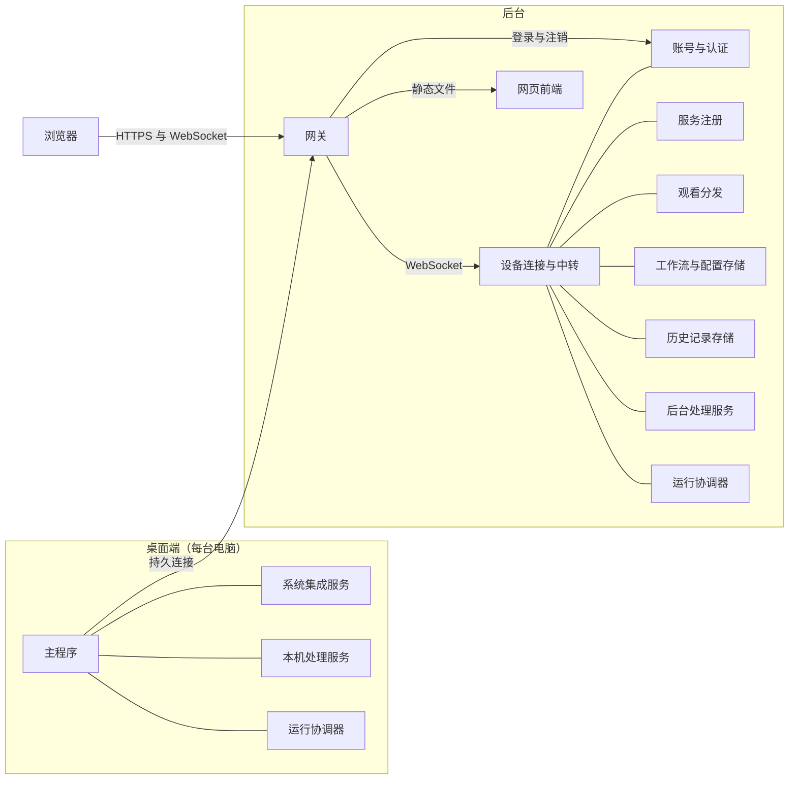

# 架构

对应需求：[产品需求](../requirements/01-product.md) 第 2、3 节，[工作流](../requirements/02-workflow.md) 第 4 至 6 节，[账号、设备与共享](../requirements/05-accounts-devices-sharing.md) 第 3、6、7 节，[服务拆分](../requirements/06-services.md)。

本文规定平台由哪些组件构成、组件之间怎样连接、一次运行中的数据沿什么路径流动，以及信任边界划在哪里。各组件的接口和实现见后续文档。

## 1 组成

平台由四部分组成：

- 桌面端：每台 Windows 或 macOS 电脑上一套，负责功能入口、屏幕采集、本机显示和本机服务；
- 后台：一组容器，负责账号、设备连接、跨设备中转、观看分发、存储和服务器侧处理；
- 浏览器：观看来源、就译文与 AI 对话、查看历史记录、编辑工作流、管理平台；
- 透传中转：只在家庭部署时使用，运行在部署者自备的公网服务器上。

## 2 桌面端

### 2.1 主程序

桌面端主程序（Desktop Agent）是常驻进程，承担以下职责：

- 界面：托盘图标或菜单栏图标，以及主窗口。主窗口包含操作面板、历史面板、设置、模型管理和运行详情，并内嵌网页版节点编辑器；
- 入口：接收全局快捷键和菜单操作，按入口绑定的工作流发起运行；
- 本机服务清单：本机服务启动后向主程序登记，主程序保存它们的描述和健康状态；
- 进程监管：按需启动本机服务进程，进程崩溃后按退避间隔重启；
- 后台链路：与后台保持一条持久连接，承载控制消息、双向的跨设备服务调用和观看数据；
- 开放控制：后台经这条连接调用本机服务时，主程序按用户勾选的开放范围放行或拒绝；
- 本机存储：工作流、入口绑定、设置、运行详情，以及加密存放的历史记录。

开放控制集中在主程序执行。用户只在桌面端勾选开放范围（需求 05 第 3.3 节），这份设置只有主程序一个执行点；本机服务只在本机进程间通信的端点上监听，不接受来自网络的连接。后台要调用本机服务，只能经过主程序，因此无法绕过用户的勾选。

### 2.2 系统集成服务

系统集成服务共八项：屏幕采集（含变化检测）、框选截图、取词、本机覆盖层、浮卡与对话面板、鼠标旁提示、快捷键与输入事件、窗口跟踪（需求 06 第 2 节）。每项服务有自己的接口和接口版本，两个平台各实现一份。屏幕采集服务中的变化检测算法是一个与平台无关的库，两个平台共用，见 05 变化检测。两个平台的系统集成服务都运行在主程序进程中，理由见 [桌面端](12-desktop.md) 1.1。

### 2.3 本机处理服务与运行协调器

本机处理服务和运行协调器，与后台容器中的同类服务是同一份实现，由主程序作为本机进程启动。它们与主程序之间、与其他本机服务之间使用本机进程间通信，消息格式与跨设备调用相同，见 08 服务协议。

## 3 后台

### 3.1 网关

网关（Ingress）是后台唯一对外监听的组件，负责三件事：

- 终止 TLS，并用 ACME 协议自动申请和续期证书；
- 按路径转发 HTTPS 请求：网页的静态文件转给网页前端，登录、注销和配对转给账号与认证；
- 把桌面端和浏览器的 WebSocket 连接转给设备连接与中转。

网关不在需求 06 列出的平台服务之内，它是部署所需的基础组件，同样以容器运行。为避免与功能"入口"混淆，本文和其他 spec 文档称它为网关。

### 3.2 平台服务

| 服务 | 职责 | 独占的数据 |
| --- | --- | --- |
| 账号与认证 | 登录、二步验证、恢复码、会话、配对码、设备凭据 | 主人账号、会话、设备 |
| 设备连接与中转 | 接受桌面端、浏览器和后台服务的持久连接，在它们之间转发服务调用和数据 | 连接状态，只在内存中 |
| 服务注册 | 保存已登记服务的描述、位置和可用状态，供节点编辑器和运行协调器查询 | 服务描述 |
| 观看分发 | 维护来源列表；缓存每路来源的显示快照和批次画面；按观看端的显示尺寸缩放画面；向浏览器推送观看数据和网页对话面板的内容 | 快照和画面，只在内存中 |
| 网页前端 | 提供网页端的静态文件 | 无 |
| 工作流与配置存储 | 保存工作流、术语表和平台设置 | 工作流与配置 |
| 历史记录存储 | 保存历史记录，执行容量上限和清理 | 历史记录 |

每个服务独占自己的数据，其他服务只能通过它的接口读写，这是需求 06 第 1 节"服务之间只通过接口通信，不共享内存和文件"在后台的落实。

### 3.3 后台处理服务与运行协调器

后台的处理服务（OCR、翻译、AI 适配、归一化、自定义 HTTP 请求）和运行协调器以容器运行。其中 AI 适配服务（AI Adapter）把外部 AI 服务，或者本机、服务器上运行的模型接入平台，对外提供语言模型、视觉模型和 AI 翻译三类接口（[技术选型](15-tech-selection.md) 第 8 节）；节点编辑器中所说的"语言模型服务""视觉模型服务"都由它提供。它们启动后连上设备连接与中转，并向服务注册登记。此后其他设备经中转调用它们，方式与调用桌面端开放的服务相同。

变化检测由源电脑上的屏幕采集服务完成（需求 06 第 3.1 节），后台没有这项服务。

## 4 透传中转

家庭部署时，后台所在的网络没有公网入口。透传中转（Pass-through Relay）运行在部署者自备的公网服务器上，一次异地访问按以下顺序建立：

1. 家里的后台运行中转连接器，主动连上中转服务器，保持一组隧道连接；
2. 异地设备连接中转服务器的 443 端口，TLS 握手中的服务器名称指示（Server Name Indication，SNI）是部署者的域名；
3. 中转按 SNI 选出对应的隧道，把这条 TCP 连接上的字节原样转发到家里的网关；
4. TLS 在家里的网关终止。

中转服务器只能看到 SNI 中的域名和加密后的字节，看不到画面和译文。证书由家里的网关申请：ACME 的 TLS-ALPN-01 质询也是一条 SNI 为部署者域名的 TLS 连接，经同一条透传路径到达家里的网关，中转服务器不需要持有证书。具体的部署方案见 14 部署与运维，可复用的开源实现见 15 技术选型。

## 5 连接与寻址

### 5.1 连接

| 连接 | 由谁建立 | 承载的内容 |
| --- | --- | --- |
| 桌面端主程序到后台 | 桌面端 | 一条持久连接：控制消息、双向的服务调用、观看数据 |
| 浏览器到后台 | 浏览器 | HTTPS 只用于登录和注销；其余操作和观看数据都经一条 WebSocket 连接，使用服务协议，由设备连接与中转路由 |
| 后台服务到设备连接与中转 | 后台服务 | 每个服务一条持久连接 |
| 本机服务之间、本机服务与主程序之间 | 双方 | 本机进程间通信 |

经过网络的连接一律使用 TLS（需求 05 第 7 节）。同一个编排网络内的后台服务直接连接设备连接与中转，这段流量不离开宿主机；部署在其他机器上的处理服务经网关连接，使用 TLS。

### 5.2 寻址与路由

一个服务实例由所在设备和它在这台设备上的登记名称共同确定（[服务协议](08-service-protocol.md) 8.1）。后台本身也算一台设备，安装时生成自己的设备标识。

运行开始时，运行协调器把工作流中每个节点的执行位置解析为具体的服务实例，规则见 [工作流定义](03-workflow.md)。之后的调用按目标位置走不同的路径：

- 目标服务与运行协调器在同一台设备上：直接走本机进程间通信；
- 目标服务在其他设备上：请求先交给本设备的转发点，经设备连接与中转送到目标设备，再由目标设备的转发点转给目标服务。

桌面端的转发点是主程序；后台的转发点是设备连接与中转本身。三个例子：

- 电脑 A 上的运行协调器调用后台的 AI 翻译服务：协调器 → A 的主程序 → 设备连接与中转 → AI 翻译服务；
- 电脑 A 上的运行协调器调用电脑 C 开放的 OCR 服务：协调器 → A 的主程序 → 设备连接与中转 → C 的主程序检查开放范围 → C 上的 OCR 服务；
- 后台的运行协调器调用电脑 A 上的 OCR 服务：协调器 → 设备连接与中转 → A 的主程序 → A 上的 OCR 服务。

每台电脑只有主程序这一条到后台的连接，设备凭据也只由主程序持有。

## 6 数据路径

### 6.1 运行协调器调度全部数据

一次运行中，运行协调器是数据的唯一调度者：服务只接收协调器发来的输入，把结果交回协调器，不把数据直接发给其他服务。画面、文字和译文都随调用一起传递，服务之间不传递数据引用。

这样规定有两条理由：

- 服务保持"输入 → 输出"的形式，同一份实现在本机进程和容器中的行为一致，也可以单独测试；
- 竞速、复用和生命周期规则都要求协调器先看到结果，再决定下一步（需求 06 第 4 节）。结果绕过协调器直接流向下一个服务，协调器就无法丢弃晚到的结果。

持续屏幕的截图不经过运行协调器逐张传递：屏幕采集服务在采集进程内完成变化检测，只把被接受为批次的画面交给运行协调器（需求 06 第 3.1 节）。没有变化的截图因此既不离开源电脑，也不离开采集进程。

### 6.2 有状态的服务

三类服务在调用之间保存状态：

- 屏幕采集服务在源电脑上保存参照画面、待处理位和上一批次的画面，见 05 变化检测；
- 系统集成服务保存界面状态，例如覆盖层上当前显示的段落；
- 观看分发保存每路来源最新的显示快照和批次画面，新连上的观看端直接取得当前画面。

### 6.3 代价与推荐的协调器位置

协调器调度全部数据的代价是：协调器与数据的来源不在同一台设备上、下一个服务又回到来源设备时，数据要传两次。例如运行协调器放在后台、OCR 绑定在源电脑上，批次画面先从源电脑传到后台，再从后台传回源电脑做 OCR。

持续屏幕的运行协调器因此推荐放在源电脑上，默认模板也这样放置（需求 02 第 2 节）。协调器放在源电脑上时，画面只在需要交给其他设备的服务或观看端时才离开源电脑，每个接收方各传一次。

### 6.4 观看数据

工作流包含网页显示节点、源电脑又开启了屏幕共享时，运行协调器在每个批次开始时把批次画面以有损压缩发给观看分发，并把显示事件持续发给它。观看分发在内存中保存最新的快照和画面，按每个观看端请求的分辨率缩放画面，再推送给浏览器。显示事件和快照的格式见 [数据模型](02-data-model.md) 第 10 节。

## 7 部署视图

### 7.1 桌面端独立使用

主程序、系统集成服务、本机处理服务和运行协调器都运行在同一台电脑上，没有后台。只有全部节点都绑定在本机的工作流可以运行（需求 02 第 4.5 节）。

### 7.2 公网服务器

后台部署在有域名或公网地址的服务器上。桌面端主程序和浏览器都主动连接后台的网关。

### 7.3 家庭部署

后台部署在家里的电脑或 NAS 上，部署者另有一台公网服务器时，异地访问使用第 4 节的透传中转。

部署者没有服务器时，首版不提供异地访问方案，部署说明建议使用离线版，即 7.1 的桌面端独立使用（需求 01 第 2.2 节）。

## 8 信任边界

| 边界 | 认证的对象 | 认证方式 |
| --- | --- | --- |
| 浏览器与后台之间 | 主人 | 账号密码、可选的二步验证、会话令牌 |
| 桌面端与后台之间 | 配对过的电脑 | 配对时签发的设备凭据 |
| 后台服务与设备连接与中转之间 | 部署者启动的服务 | 部署时生成的服务凭据 |
| 本机服务与主程序之间 | 主程序启动的本机进程 | 主程序启动时生成、经标准输入下发的本机会话令牌，加上操作系统对进程间通信端点的访问控制 |
| 平台与外部服务之间 | 用户配置的 AI、翻译和自定义 HTTP 地址 | 用户配置的凭据 |

各边界的具体机制见 11 安全。
