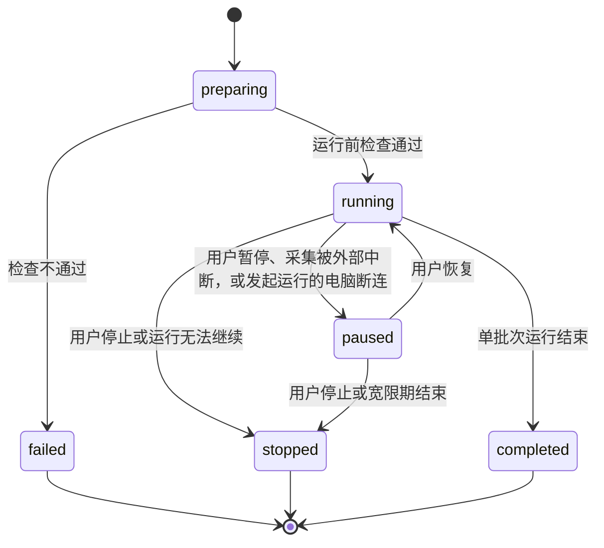

# 运行协调器

对应需求：[运行与生命周期](../requirements/04-run-lifecycle.md) 全文，[OCR 与竞速翻译](../requirements/03-ocr-and-translation-race.md) 第 4、5 节，[工作流](../requirements/02-workflow.md) 第 4 节，[服务拆分](../requirements/06-services.md) 第 4、6、7 节。

本文规定运行协调器（Run Coordinator）怎样执行一次运行：运行与批次的状态机、持续屏幕的批次调度、段落复用、译文缓存、竞速算法、请求的排队与取消、暂停与停止、手动控制、显示事件的产生，以及断连和故障时的行为。数据结构见 [数据模型](02-data-model.md)，工作流的结构见 [工作流定义](03-workflow.md)。

## 1 职责

运行协调器是一个服务进程，可以同时执行多次运行，例如几台电脑各自发起的运行，或者同一台电脑上的一个持续屏幕运行和一次划词。每次运行的状态相互独立。首版每台电脑同时只有一个持续屏幕运行（需求 01 第 4.2 节），主程序在发起新的持续屏幕运行之前检查这一点。

对一次运行，运行协调器负责：

- 运行前检查，冻结这次运行的配置；
- 按工作流的数据依赖调用各个服务，并在服务之间传递数据（[架构](01-architecture.md) 6.1）；
- 管理运行、批次、段落竞速和请求四层生命周期；
- 持续屏幕的段落复用和译文缓存；
- 竞速；
- 请求的分组、排队、限速、超时、重试和取消；
- 把显示内容的变化写成显示事件，发给每个显示节点；
- 记录批次记录和运行详情。

## 2 运行

### 2.1 状态

| 状态 | 含义 |
| --- | --- |
| `preparing` | 正在做运行前检查 |
| `running` | 运行中 |
| `paused` | 持续屏幕已暂停，保留复用所需的状态和译文缓存 |
| `completed` | 单批次运行正常结束 |
| `stopped` | 用户停止，或者运行无法继续 |
| `failed` | 运行前检查不通过，运行没有开始 |



只有持续屏幕运行可以暂停。单批次运行在以下时刻进入 `completed`：

- 单次截图：唯一的批次结束时；
- 划词和图片问 AI 的对话用法：显示结果的浮卡或对话面板关闭时。浮卡和对话面板打开期间，用户可以追问，追问是同一次运行中的新请求；
- 图片问 AI 的鼠标旁提示用法：回答带完成标记时。回答完成之前提示被关闭的，运行取消未完成的请求后结束（[服务接口](09-service-interfaces.md) 第 9 节）。

单批次运行在发起运行的电脑断连时直接进入 `stopped`，只有持续屏幕运行转为暂停（第 12 节）。

### 2.2 冻结配置

`preparing` 阶段完成三件事：

1. 复制工作流文档，计算它的 SHA-256 摘要，记入运行记录；
2. 按 [工作流定义](03-workflow.md) 6.3 做运行前检查，把每个绑定解析为服务实例；
3. 为每个显示节点建立一条显示流。

此后这份副本就是这次运行的全部配置。用户在运行期间修改工作流，只改动存储中的文档，不影响这份副本（需求 04 第 2 节）。

## 3 持续屏幕的批次调度

### 3.1 拉取批次

参照画面、待处理位和上一批次的画面都保存在源电脑的屏幕采集服务中，它同时完成变化检测，见 05 变化检测。运行协调器在运行开始时打开一个采集会话，之后反复向屏幕采集服务取下一个批次：

```text
procedure run_continuous(run):
    open_session(screen_capture, screen_input 的参数)
    while run.state = running:
        b ← take_batch(screen_capture, wait = 1 秒)
        if b 为空:
            continue                  -- 等待期间画面没有变化，回到循环开头检查运行状态
        process_batch(run, b)         -- 批次结束后才返回
```

`take_batch` 在待处理位中有画面时立即返回，否则最多等待 `wait`；返回时，屏幕采集服务一并完成三件事：

1. 把待处理位中的画面记为新的"上一批次画面"；
2. 算出它相对原来的上一批次画面的变化图；
3. 清空待处理位。

运行协调器在当前批次结束后才调用下一次 `take_batch`。这正是需求 04 第 3.2 节的规则："当前批次的所有段落竞速都结束，或者达到批次总时限后，处理端取出待处理位中的截图，开始下一个批次"。待处理位只由屏幕采集服务一方读写，运行协调器即使在后台，也不需要与源电脑同步待处理位的状态。

批次序号 `batch_seq` 由运行协调器在一次运行内统一编号（[总览](00-overview.md) 3.3）。屏幕采集服务只给每张成为批次的画面一个 `frame_id`，变化图用它标明比对的是哪两张画面。采集会话重新打开时，例如后台断连后恢复运行（第 8 节），批次序号照常递增，同一次运行内不会重复。

`wait` 取 1 秒，让循环至少每秒检查一次运行状态；暂停和停止通过第 8 节的流程直接中断等待，不依赖这个间隔。

### 3.2 一个批次的处理

```text
procedure process_batch(run, b):
    run.batch_seq ← run.batch_seq + 1                            -- 运行协调器编号，见 3.1
    seq ← run.batch_seq
    deadline ← now() + T_D
    plan ← plan_reuse(run, b.change_map)                         -- 第 4 节
    给复用的段落编号 1 至 R
    emit batch_start(seq, b.frame, b.geometry, carried = plan.reused, held = plan.held)
    run.ocr_done ← true
    new_units ← 空
    if plan.ocr_regions 非空:
        result ← call ocr(crop(b.frame, plan.ocr_regions))        -- 第 7 节的排队与超时
        if OCR 或下面的归一化失败、超时:
            run.ocr_done ← false                                  -- 下一个批次整张重新识别，见 4.2
        else:
            drop_duplicates(result, plan.reused)                  -- 第 4.5 节
            new_units ← call normalize(result, plan.reused, first_id = R + 1)
    identify_languages(new_units)                                 -- 第 3.4 节
    takeover ← match_held(plan.held, new_units)                   -- 第 4.6 节
    for each 新段落 u:
        emit paragraph_add(u, takes_over = takeover[u])
    emit held_release(plan.held 中没有被接替的段落)
    for each 竞速节点 N:
        for each 新段落 u:
            if cache[N] 中有 κ(u):
                显示缓存的译文，结束状态记为完整结果，via = cache    -- 第 5 节
            else:
                start_race(N, u)                                  -- 第 6 节
        dispatch_requests(N)                                      -- 第 7 节
    wait until 本批次的竞速都结束 or now() ≥ deadline            -- 不等手动重试重新打开的竞速，见第 9 节
    if now() ≥ deadline:
        on_deadline(run)                                          -- 第 6.5 节
    emit batch_end(seq, ended_by)
    run.prev_batch ← 本批次的段落与竞速记录
```

`batch_start` 在 OCR 之前发出。显示端在批次开始时切换到新批次（需求 04 第 3.6 节）：复用的段落立即移到新位置，保留段落原样显示，网页观看端换上新的批次画面；新段落要等 OCR 和归一化完成后才出现，保留段落在同一时刻被接替或撤下（4.6 节）。OCR 失败时没有新段落，全部保留段落在 `held_release` 中撤下。

复用的段落在 `batch_start` 时就要有新标识，所以运行协调器先给它们编号 1 至 $R$，再让归一化从 $R+1$ 开始给新段落编号。归一化同时收到复用段落的新位置，用来确定全部段落的阅读顺序，但不改动复用段落的内容（需求 04 第 3.5 节）。

运行的第一个批次没有上一批次，整张画面送去 OCR。

### 3.3 段落交给其他节点

持续屏幕工作流中，归一化输出的 `Units` 包含本批次的全部段落，复用的段落 `origin` 为 `reused`。各节点收到后的处理方式不同：

- 竞速的翻译源只为需要竞速的段落发请求，由竞速统一调度；
- 其他节点收到全部段落。AI 对话节点在持续屏幕中有一个参数"只处理新段落"，默认打开，避免每个批次都把没有变化的段落重新交给 AI。

### 3.4 语言识别

每个段落在交给翻译源之前要有确定的语言，源语言为 `auto` 时也是如此：Bergamot 这类引擎自己不判断源语言，要按语言选择模型（[技术选型](15-tech-selection.md) 7.1）。运行协调器按以下顺序确定段落的语言：

1. OCR 给出了这个段落的语言，即归一化填写了 `language`，直接使用；
2. 否则用语言识别库按原文判断（[技术选型](15-tech-selection.md) 第 7.5 节），结果写入 `language`；
3. 原文太短、识别库给不出把握足够的结果时，`language` 留空。翻译源声明能自行判断源语言的，交给它判断；不能的，这一段对这个源按单段失败处理，原因是"无法判断源语言"。

识别结果只用于选择翻译方向，不改变原文。划词注入的翻译单元同样经过这一步（第 11.2 节）。

判断翻译源是否支持某种语言时，按 [总览](00-overview.md) 3.5 的规则比较标签。段落的语言不在某个翻译源支持的范围内时，这一段对这个源按单段失败处理，原因是"不支持这种语言"。

## 4 段落复用

### 4.1 输入

复用判定使用三项输入：

- 上一批次的全部段落，包括每个段落的原始框（上一批次画面的像素坐标），以及它在每个竞速节点上的结束状态；
- 新批次的变化图，见 [数据模型](02-data-model.md) 第 7 节；
- 运行参数 $\theta$、$\delta$、$m$，见 [工作流定义](03-workflow.md) 第 7 节。

### 4.2 整张重新识别

以下任一情况成立时，本批次不复用任何段落，也没有保留段落，整张画面送去 OCR：

- 这是运行的第一个批次；
- 变化图为空：采集会话是新打开的，没有上一批次的画面可以比对，例如后台断连后恢复运行（第 8 节）；
- 变化图的 `changed_ratio` 大于 $\theta$，包括画面尺寸改变时 `changed_ratio` 为 1 的情况；
- 上一批次的 OCR 或归一化没有完成，即 `run.ocr_done` 为假：被暂停打断、失败或超时（需求 04 第 3.5 节）。上一批次的画面已经成为比对的基准，没有识别完的区域里没有段落，按变化图比对会被当作没有变化，此后再也不会被识别。

整张重新识别时，译文缓存照常生效：翻页后再翻回来，回来那一页的段落仍然命中缓存。

### 4.3 判定每个段落

记段落 $P$ 的原始框为 $q_1, \dots, q_n$，第 $k$ 个候选位移为 $d_k = (d_x^k, d_y^k)$。原始框 $q_i$ 平移 $d_k$ 后覆盖的像素矩形为：

$$
R_i(k) = \operatorname{px}(q_i) + d_k
$$

$\operatorname{px}$ 的定义见数据模型 1.2。记与矩形 $R$ 相交的方块集合为 $\mathcal{T}(R)$，方块 $T$ 的第 $k$ 位为 $\beta_k(T)$。

段落 $P$ 在位移 $k$ 下一致，当且仅当对每个原始框 $q_i$：

$$
R_i(k) \subseteq [0, W) \times [0, H) \quad \text{且} \quad \forall\, T \in \mathcal{T}(R_i(k)):\ \beta_k(T) = 1
$$

按 $k = 0, 1, 2, \dots$ 的顺序检查，取第一个使 $P$ 一致的位移，记为 $k^*$。屏幕采集服务按支持面积从大到小排列候选位移（05 变化检测），所以 $k = 0$ 之后先检查的是覆盖面积最大的那次滚动。

段落 $P$ 被复用，当且仅当以下四个条件同时成立，它们依次对应需求 04 第 3.5 节的四个条件：

1. 存在 $k^*$。$k^* = 0$ 是原地未变，$k^* \ge 1$ 是整体平移；
2. 平移后完整位于新画面之内。这一条已经包含在"一致"的定义中：$R_i(k^*)$ 必须落在画面之内；
3. 不与变化区域相邻，判定方法见下文；
4. 工作流中处理过这个段落的每个竞速节点，都以完整结果结束。工作流中没有竞速节点时，这一条自动成立。

条件 3 在方块网格上判定。记变化方块（字节为 0 的方块）的集合为 $C$，取 $r = \lceil \delta / t \rceil$，把 $C$ 按切比雪夫距离向外扩展 $r$ 个方块：

$$
C_r = \{\, T_{u,v} \mid \exists\, T_{u',v'} \in C,\ \max(|u - u'|,\ |v - v'|) \le r \,\}
$$

条件 3 成立，当且仅当每个 $\mathcal{T}(R_i(k^*))$ 与 $C_r$ 都不相交。

这个判定保证段落与任何变化像素的距离大于 $\delta$。证明如下：设像素 $(x, y)$ 属于段落覆盖的方块 $T_{u,v}$，变化像素 $(x', y')$ 属于变化方块 $T_{u',v'}$。由于 $T_{u,v} \notin C_r$，有 $\max(|u - u'|, |v - v'|) \ge r + 1$，不妨设 $u' \le u - (r+1)$。方块 $u'$ 中的像素横坐标最大为 $(u'+1)t - 1$，方块 $u$ 中的像素横坐标最小为 $ut$，所以：

$$
x - x' \ \ge\ ut - \big((u'+1)t - 1\big) \ \ge\ ut - (u - r)t + 1 \ =\ rt + 1 \ >\ \delta
$$

最后一步用到 $rt = \lceil \delta/t \rceil t \ge \delta$。其他三个方向同理。

这个判定偏保守：距离在 $\delta$ 到 $(r+1)t$ 之间的段落也可能被判为相邻，于是重新识别。多识别一段只多花一次 OCR，判漏则会把半句话的旧译文留在画面上，所以取保守的一侧。

### 4.4 复用的正确性

被复用的段落 $P$，在新画面中的像素与它在旧画面中的像素逐个一致（色差不超过 $\tau$）。证明：$P$ 在位移 $k^*$ 下一致，所以覆盖每个 $R_i(k^*)$ 的方块的第 $k^*$ 位都为 1。按变化图的定义，这些方块中的每个像素 $(x, y)$ 都满足：

$$
\lvert N_c(x, y) - O_c(x - d_x^{k^*},\ y - d_y^{k^*}) \rvert \le \tau
$$

$R_i(k^*)$ 包含在这些方块的并集中，所以 $R_i(k^*)$ 中的每个像素都与旧画面中 $\operatorname{px}(q_i)$ 的对应像素一致。对这块区域重新识别，引擎看到的是与上一批次相同的像素，沿用上一批次的识别结果因此不损失准确性。

这个结论只覆盖原始框以内的像素。OCR 引擎给出的框有时不能完全包住文字，例如上方的声调符号落在框外。框外的变化由条件 3 处理：变化发生在框外 $\delta$ 以内时，段落不被复用。

### 4.5 送去 OCR 的区域

送去 OCR 的区域按以下步骤得到：

1. 在方块网格上求变化方块的八连通块，每个连通块取外接矩形；
2. 对每个不被复用的段落，取它的原始框在新画面中的位置：存在 $k^*$ 时为 $R_i(k^*)$；不存在时，按 $k = 0, 1, 2, \dots$ 的顺序找第一个"画面内部分一致"的位移 $k'$，即每个 $R_i(k')$ 与画面的交集非空，并且与这个交集相交的方块的第 $k'$ 位都为 1，取 $R_i(k') \cap ([0, W) \times [0, H))$；仍然找不到时，取 $\operatorname{px}(q_i)$；
3. 把以上矩形各自向外扩展 $m$ 像素，裁到画面之内；
4. 反复把相交或相邻的两个矩形替换为它们的外接矩形，直到没有相交或相邻的矩形。

第 1 步先在方块网格上合并，再处理矩形。3840×2160 的画面取 $t = 16$ 时共 32400 个方块，变化方块可以多达上万个，连通块却少得多：05 变化检测第 5 节的测量中，17742 个变化方块只分属 10 个连通块。第 4 步的两两合并因此只在少量矩形之间进行。

第 2 步中"画面内部分一致"处理部分滚出画面的段落。内容上滚 100 像素时，原来位于 $y \in [50, 150)$ 的段落，留在新画面中的部分位于 $[0, 50)$。这一段在滚动位移下不满足"一致"，因为它的一部分落到了画面之外；但画面内剩下的部分与旧画面一致，所在的方块不算变化方块，第 1 步不会选中它，旧位置 $[50, 150)$ 也不覆盖它。没有这条规则，剩下的半段文字就永远不会被重新识别，而需求 04 第 3.5 节要求这部分按新画面重新识别和翻译。

扩展边距 $m$ 是为了不切断文字行（需求 04 第 3.5 节），代价是扩展后的区域与被复用的段落重叠时，同一段文字会被识别两次。OCR 返回后，运行协调器丢弃重复的文字块：文字块的像素范围与某个被复用段落在新画面中的外接矩形的交集，占文字块面积的一半以上时，丢弃这个文字块。复用的段落优先，它已经有完整的译文。

### 4.6 保留显示的段落

不被复用的段落中，按 4.5 第 2 步得到的位置就是它原来的位置时，即 $k^* = 0$、$k' = 0$，或者两者都不存在，这个段落作为保留段落列入 `batch_start` 的 `held`（需求 04 第 3.6 节）。$k^* \ge 1$ 或 $k' \ge 1$ 的段落随画面移动了，原来位置上的译文已经对不上，在 `batch_start` 时撤下。整张重新识别的批次没有保留段落（4.2）。

OCR 和归一化完成后，`match_held` 为每个保留段落 $h$ 找接替它的新段落 $u$。记连着显示节点的竞速节点为 $N_d$（[工作流定义](03-workflow.md) 6.2 第 14 条保证它只有一个），$u$ 接替 $h$ 的条件是以下三条同时成立：

1. 原文相同：$\kappa(u) = \kappa(h)$，$\kappa$ 见第 5 节；
2. 位置重合：两者外接矩形的交并比不低于 0.5；
3. 命中缓存：$N_d$ 的译文缓存中有 $\kappa(u)$。

两个矩形 $A$、$B$ 的交并比为：

$$
\mathrm{IoU}(A, B) = \frac{\lvert A \cap B \rvert}{\lvert A \cup B \rvert}
$$

满足条件的组合有多个时，按交并比从大到小一一配对：每个保留段落最多被一个新段落接替，每个新段落最多接替一个保留段落。被接替的保留段落随新段落的 `paragraph_add` 撤下，新段落按第 5 节命中缓存，显示同一份译文，画面上没有空白。其余保留段落列入 `held_release`。

交并比取 0.5 的依据：保留段落的位置没有变化，同一段文字重新识别后的外接矩形与原来的几乎重合，交并比接近 1；同一画面中相邻的两个段落互不重叠，交并比为 0。0.5 能吸收识别框的抖动，又不会把相邻的段落配错。

第 3 条要求命中缓存。上一批次以完整结果结束的段落，译文已经在缓存中，接替后显示的就是同一份译文。没有以完整结果结束的段落，缓存中没有它的译文，保留段落撤下，新段落重新竞速，与需求 04 第 3.5 节的条件 4 一致。

## 5 译文缓存

每个竞速节点有一份译文缓存，键为规范化的原文 $\kappa(u)$，规则见 [数据模型](02-data-model.md) 第 8 节。

- 查找：每个新段落在开始竞速之前查找。命中时直接显示缓存中的译文，结束状态记为完整结果，`via` 为 `cache`，不向任何翻译源发请求；
- 写入：段落竞速以完整结果结束、`via` 为 `race` 时写入；
- 淘汰：缓存容量为运行参数 `cache_capacity`，满了以后淘汰最久没有被查中的一项。查中一项时，把它标为最近使用；
- 生命周期：暂停时保留，停止时清空（需求 04 第 3.5 节）。

只有首选源的完整译文会进入缓存，这一点由写入条件保证：结束状态为完整结果，意味着显示的是首选源带完成标记的候选，见 6.5。

## 6 竞速

### 6.1 记号

考虑某个批次中段落 $u$ 在竞速节点 $N$ 上的竞速，记录为 $\mathcal{R}$，字段见数据模型第 6 节。$N$ 的翻译源按名次排列为 $s_1, s_2, \dots, s_n$，$s^* = s_1$ 是首选源，$r(s)$ 是源 $s$ 的名次。

候选 $c = (s, v, f)$ 是有效候选，当且仅当以下条件全部成立（需求 03 第 5.2 节）：

1. 属于当前运行；
2. 属于当前批次；
3. 段落 $u$ 在当前批次中存在；
4. 产生它的请求没有被取消；
5. $\mathcal{R}$ 尚未结束，或者被手动重试重新打开（第 9 节）。

第 5 条处理一次请求包含多个段落的情况：段落 $u$ 的竞速已经结束，但请求还在为其他段落工作，没有被取消，它后续送来的 $u$ 的候选也不能再改变 $u$ 的显示。

### 6.2 新候选

```text
procedure on_candidate(R, c = (s, v, f, text)):
    if not valid(R, c): 记入运行详情; return
    o ← R.sources[s]; o.has_output ← true; o.last_version ← v
    if R.shown = error:
        if not (R 因手动重试首选源而重新打开 and s = s*): return
        replace ← true                           -- 第 9 节
    else:
        replace ← R.shown = none
                  or r(s) < r(R.shown.source)
                  or (s = R.shown.source and v > R.shown.version)
    if replace:
        R.shown ← c
        emit paragraph_show(u, text, r(s), v, f)
    if s = s* and f:
        o.state ← finished
        finish(R, settled); return
    if f: o.state ← finished
    prune(R)
    if R 没有仍在运行的源能影响显示:
        finish(R, all_ended)
```

`R.shown` 为错误、而候选不是来自手动重试的首选源时，直接返回。这条分支只在源的请求被提前结束之前候选已经在路上时出现；这些候选在 `finish` 之后到达，按有效性规则的第 5 条已被丢弃，所以这里只是防御。

替换条件中的 $r(s) < r(s_d)$ 等价于需求 03 第 5.3 节的 $p(s) > p(s_d)$，由数据模型第 5 节的 $p(s) = n + 1 - r(s)$ 直接得出。完成标记不参与替换判断，与需求一致。

### 6.3 失败的分类与整体不可用

翻译源的一次失败分为两类（需求 03 第 5.4 节）：

| 类别 | 判定依据 |
| --- | --- |
| 整体不可用 | 与服务所在设备的连接断开；流以 [服务协议](08-service-protocol.md) 第 7 节中归为"整体不可用"的状态码结束 |
| 单段失败 | 流以第 7 节中归为"单段失败"的状态码结束；请求超过节点超时；`translate` 接口对某一段回复 `ParagraphFailed`；流式输出没有给出完成标记就结束 |

两类的划分以服务协议第 7 节的状态码表为准，依据是失败是否与这次请求的内容有关。自定义 HTTP 接口节点作为翻译源时，`http_request.Send` 本身正常结束，外部接口的错误写在回复的 HTTP 状态码里，运行协调器按 [服务接口](09-service-interfaces.md) 第 15 节的映射把它归入这两类。服务重启后版本不兼容，与具体段落无关，所以归入整体不可用；需求 06 第 6 节只要求"这个节点按失败结束"，归入整体不可用后，作为首选源时段落保留其他源的临时译文并给出整体提示，不会让每一段都变成错误提示。

整体不可用是服务一级的状态。运行协调器为每个服务实例维护一个可用状态，每种原因有自己的恢复条件：

| 状态码或原因 | 恢复的条件 |
| --- | --- |
| 连接断开，或者中转报告目标不可达 | 服务注册通知该设备重新上线，或者该服务重新登记 |
| 服务自己返回 `unavailable`，连接仍在 | 按探测间隔（默认值待定）发出的一次探测调用成功；服务自己的上游，例如外部 AI 接口，恢复后即可用 |
| `rate_limited` | 服务给出的重试等待时间已过；服务没有给出时，等待默认的退避时长（默认值待定） |
| `quota_exceeded` | 服务注册通知这项服务的上限已调高，或者进入了新的计费周期 |
| `incompatible`、`unimplemented` | 服务以兼容的版本重新登记 |
| `permission_denied` | 服务注册通知这项服务重新开放，即电脑的主程序重新登记了包含它的开放列表 |

"该服务重新登记"的通知有两条来路：后台服务和电脑开放的服务重新登记时，服务注册经 `Watch` 通知；运行协调器在本机时，本机服务重新登记由主程序在 `agent.Acquire` 的流上推送（[服务接口](09-service-interfaces.md) 第 3 节）。桌面端独立使用时没有服务注册，只有后一条。

设备连接与中转因为一条连接上的流已满而拒绝新调用时，回复 `rate_limited` 并附带重试等待时间（[后台平台服务](10-backend.md) 第 2 节）。这只是暂时的限制，按限流处理，等待时间过后即恢复。

服务处于不可用状态时，发给它的请求不经网络，直接按整体不可用失败。一个服务转为不可用时，它正在执行的全部请求按整体不可用失败，影响所有以它为翻译源的段落。

失败的处理：

```text
procedure on_failure(R, s, 类别, 原因 = settled):
    o ← R.sources[s]
    if s ≠ s*:
        o.state ← (类别 = 整体不可用 ? unavailable : failed)
        prune(R)
        if R 没有仍在运行的源能影响显示: finish(R, all_ended)
        return                                  -- 显示保持不变，不提示
    if 类别 = 整体不可用:
        o.state ← unavailable
        raise_notice(N, preferred_unavailable)   -- 整体提示
        prune(R)
        if R 没有仍在运行的源能影响显示: finish(R, all_ended)
    else:
        o.state ← failed
        if not o.has_output:
            R.shown ← error
            emit paragraph_show(u, error, 原因)
        finish(R, 原因)                          -- 批次总时限触发时为 deadline，见 6.5
```

整体提示与可用状态同步：竞速节点的首选源转为不可用时发出 `notice`（`active` 为真），恢复可用时再发一次（`active` 为假）。

首选源在批次中途恢复时，本批次已经以临时结果结束的段落不自动重新请求：需求 04 第 5 节规定失败后默认不自动重试。持续屏幕的画面不再变化时就不会产生新批次，这些段落会一直显示临时译文。为此，整体提示撤下时，主程序发出一条系统通知，说明首选源已经恢复，用户可以对当前批次手动重试首选源（第 9 节）。这条提醒不画在显示画面上，显示画面上的提示仍只有需求 04 第 7 节规定的两种。

### 6.4 提前结束不再需要的源

仍在运行的源 $s$（状态为 `queued` 或 `running`）能影响显示，记为 $\mathrm{can\_affect}(s)$，按需求 03 第 5.7 节定义：

- $\mathcal{R}$ 显示错误：不能；
- $\mathcal{R}$ 没有显示任何候选：能；
- $\mathcal{R}$ 显示候选 $d = (s_d, v_d, f_d)$：当且仅当 $r(s) < r(s_d)$，或者 $s = s_d$ 且 $f_d$ 为假。

```text
procedure prune(R):
    for each 仍在运行的源 s:
        if not can_affect(R, s):
            R.sources[s].state ← pruned
            release(s 的请求, u)                 -- 第 7.3 节
```

`release` 只表示段落 $u$ 不再需要这个请求。一次请求包含多个段落时，所有段落都释放了它，并且没有保存到历史记录等其他用途需要它的输出时，运行协调器才取消这个请求（需求 03 第 5.7 节）。

### 6.5 结束状态

```text
procedure finish(R, 原因):
    if R 已结束: return
    R.ended_by ← 原因
    把 R 中仍在运行的源都标为 pruned，并 release 它们的请求
    R.end_state ← end_state(R, 原因)
    emit paragraph_end(u, R.end_state, R.via)
    if R.end_state = complete and R.via = race:
        cache[N].put(κ(u), R.shown_text)
    记入运行详情

function end_state(R, 原因):
    if R.shown 是 s* 的候选 and 带完成标记: return complete
    if R.shown 是 s* 的候选: return partial
    if R.shown = error: return error
    if R.sources[s*].state = unavailable: return provisional
    if 原因 ∈ {pause, stop, cancel} or R.sources[s*].state = cancelled: return aborted
    return error                                 -- 不会到达，见 6.6
```

倒数第二个分支包含首选源已被用户取消的情况：取消首选源后，用户还可以重试其他源（第 9 节），重新打开的竞速以 `all_ended` 结束，这时首选源的结果同样不会到来，原因是用户取消了它，所以记为中止。

`end_state` 中各分支的顺序就是判定的优先级。例如首选源整体不可用之后用户又暂停了运行，段落记为临时结果：首选源的结果无论如何都不会到来，这比"用户暂停"更准确地说明了段落为什么没有最终译文。

批次总时限到达时：

```text
procedure on_deadline(run):
    for each 本批次尚未结束、不是由手动重试重新打开的竞速 R:      -- 手动重试见第 9 节
        if R.sources[s*].state ∈ {queued, running}:
            on_failure(R, s*, 单段失败, deadline) -- 首选源超时
        else:
            finish(R, deadline)
```

`ended_by` 的每个取值只由一条路径产生：

| 取值 | 产生的路径 |
| --- | --- |
| `settled` | 首选源给出带完成标记的候选；或者首选源对这一段单段失败，在批次总时限之前 |
| `all_ended` | 首选源已经不在运行（整体不可用、被提前结束、被用户取消），其余仍在运行的源都已无法影响显示 |
| `deadline` | 批次总时限到达，包括首选源因此按超时处理 |
| `pause`、`stop` | 用户暂停、停止运行，或者采集被外部中断（按暂停处理）|
| `cancel` | 用户手动取消首选源的调用（第 9 节）|

首选源超时时已经给出过译文，段落保留它的文字，以部分结果结束；没有给出任何译文，段落显示错误。这与需求 04 第 4 节一致。首选源还在排队、一次都没有发出时，同样按超时处理，段落显示错误：批次总时限是整个批次的上限，排队消耗的时间也计算在内。用户遇到这种情况，可以调高请求速率上限或批次总时限，或者减少每批次的请求数，估算方法见 7.2。

### 6.6 性质

以下四条性质保证竞速算法与需求一致。

#### 性质 1：结束状态的判定没有遗漏

先证明一个引理：首选源只要给出过有效候选，`shown` 就是首选源的某份候选，除非之后被显式设为错误。首选源的名次为 1，小于任何其他源，它的第一份有效候选对任何其他来源的显示都满足替换条件 2；`shown` 为空时满足条件 1；`shown` 为错误时，只在首选源没有任何输出时才会被设置，与"给出过候选"矛盾，手动重试的情况由第 9 节单独允许替换。此后只有首选源自己的新版本能替换它。

`end_state` 的最后一个分支不会到达。证明：竞速只在以下五种情况下结束，逐一检查。

- 首选源给出带完成标记的候选：`shown` 是 $s^*$ 的完成候选，返回完整结果；
- 首选源单段失败：`on_failure` 把 `shown` 设为错误，或者 $s^*$ 已有输出、`shown` 是 $s^*$ 的候选，分别返回错误和部分结果；
- 没有仍在运行的源能影响显示，或者全部源都已结束：此时 $s^*$ 不在运行。原因是 $s^*$ 在运行时总能影响显示：`shown` 为空时能；`shown` 是其他源 $s_d$ 的候选时，$r(s^*) = 1 < r(s_d)$；`shown` 是 $s^*$ 的候选时，它还在运行说明这份候选没有完成标记。`shown` 为错误的情况已由上一种覆盖。$s^*$ 不在运行，它的状态只能是正常结束（已有完成候选，返回完整结果）、失败（已由上一种覆盖）、整体不可用（返回临时结果，或者已有输出时返回部分结果）、被用户取消（状态为 `cancelled`，已有输出时返回部分结果，否则返回中止）。被取消后，竞速有两种结束方式：因取消本身结束，原因为 `cancel`；用户之后重试其他源（第 9 节），重新打开的竞速以 `all_ended` 结束。两种都由倒数第二个分支按首选源的 `cancelled` 状态覆盖；
- 批次总时限：$s^*$ 仍在运行时转为单段失败；否则同上一种；
- 暂停、停止或取消：`shown` 是 $s^*$ 的候选时返回部分结果，$s^*$ 不可用时返回临时结果，否则返回中止。

五种情况都在最后一个分支之前返回。

#### 性质 2：被提前结束的源不会再改变显示

设源 $s$ 在某时刻被提前结束，此时 `shown` 为 $d = (s_d, v_d, f_d)$，或者为错误。

`shown` 为错误时，只有手动重试首选源才能替换它，而手动重试会显式地重新启动源（第 9 节），不属于这里讨论的情况。

`shown` 为 $d$ 时，$s$ 被提前结束，说明 $\mathrm{can\_affect}(s)$ 为假。按定义，$\mathrm{can\_affect}(s)$ 为真当且仅当 $r(s) < r(s_d)$，或者 $s = s_d$ 且 $f_d$ 为假。它为假，即以下两条同时成立：

$$
r(s) \ge r(s_d), \qquad s \ne s_d \ \text{或}\ f_d \ \text{为真}
$$

名次两两不同，所以 $r(s) \ge r(s_d)$ 分为两种情况。

情况一，$s \ne s_d$，于是 $r(s) > r(s_d)$。由需求 03 第 5.3 节的性质 2，此后显示内容的来源名次只降不升，此后任意时刻显示的来源 $s'$ 都满足 $r(s') \le r(s_d) < r(s)$。$s$ 的后续候选要替换显示，要么需要 $r(s) < r(s')$，与上式矛盾；要么需要 $s = s'$，而 $r(s') < r(s)$ 说明 $s' \ne s$。两条都不成立。

情况二，$s = s_d$，于是 $f_d$ 为真：$s$ 已经给出了这一段带完成标记的候选，对这一段的输出已经正常结束，不会再有新版本。显示的来源此后只可能被名次更小的源替换，同样轮不到 $s$。

两种情况下，$s$ 被提前结束后都不会再改变显示，所以提前结束不改变显示的任何结果。

#### 性质 3：每个竞速都会结束

批次中的每个竞速最晚在批次总时限到达时结束：`on_deadline` 对每个尚未结束的竞速都调用 `finish`，或者经 `on_failure` 结束它。

手动重试重新打开的竞速不受批次总时限约束（第 9 节），它同样会结束：重试的请求受节点超时约束，超时按单段失败处理；下一个批次开始、暂停或停止时，它按第 9 节第 5 步结束。

#### 性质 4：缓存和复用只沿用首选源的完整译文

缓存只在结束状态为完整结果时写入，复用的条件 4 要求结束状态为完整结果。完整结果意味着显示的是首选源带完成标记的候选，所以缓存和复用都只沿用首选源的完整译文（需求 03 第 5.8 节）。

## 7 请求调度

### 7.1 分组

每个批次中，对每个翻译源节点，运行协调器把需要竞速的段落按阅读顺序分成若干组，每组发一次请求。一组最多包含 $U$ 个段落、$L$ 个字符：$U$ 取节点参数"每次请求最多包含的段落数"，$L$ 取服务登记时声明的上限。

开启上下文选项的 AI 翻译源，请求中另外附带本次运行中、按阅读顺序排在这组段落之前的若干段原文，作为参考，不要求翻译。

### 7.2 排队与限速

并发上限和速率上限按服务实例计算，不按节点计算：两个节点绑定同一个服务，共用这个服务的上限。上限的默认值由服务登记时给出，用户可以调低（需求 04 第 10 节）。

每个服务实例有一个先进先出的队列、一个并发计数和一个令牌桶。令牌桶的容量为 $b$，每秒补充 $r$ 个令牌。设上一次补充在时刻 $t_0$，此时有 $k(t_0)$ 个令牌，则时刻 $t$ 的令牌数为：

$$
k(t) = \min\big(b,\ k(t_0) + r\,(t - t_0)\big)
$$

队首的请求在并发数小于上限 $c$ 并且 $k(t) \ge 1$ 时发出，发出时消耗一个令牌。

用户估算一个批次能否在批次总时限内完成时，可以用以下推导。设某个源在一个批次中要发出 $Q$ 次请求，令牌桶开始时是满的，每次请求耗时 $T_q$。记第 $Q$ 次请求的发出时刻为 $t_Q$，两个上限各给出它的一个下界。

令牌桶的下界：到时刻 $t$ 为止，最多能取得 $b + r t$ 个令牌，也就最多发出 $b + rt$ 次请求。第 $Q$ 次请求发出时 $b + r t_Q \ge Q$，所以 $Q > b$ 时：

$$
t_Q \ge \frac{Q - b}{r}
$$

并发上限的下界：同时最多 $c$ 个请求在执行，每个占用 $T_q$。到时刻 $t$ 为止，每个并发位置最多完成 $\lfloor t / T_q \rfloor$ 次请求，全部位置合计最多完成 $c \lfloor t / T_q \rfloor$ 次。$Q > c$ 时，第 $Q$ 次请求要等前面至少 $Q - c$ 次完成、腾出位置才能发出，所以 $c \lfloor t_Q / T_q \rfloor \ge Q - c$，即：

$$
t_Q \ \ge\ \left\lceil \frac{Q - c}{c} \right\rceil T_q \ =\ \left( \left\lceil \frac{Q}{c} \right\rceil - 1 \right) T_q
$$

这个源在本批次的结果最早在 $t_Q + T_q$ 时到齐。要在批次总时限内完成，以下条件必须成立：

$$
\max\left( \frac{\max(0,\ Q - b)}{r},\ \left( \left\lceil \frac{Q}{c} \right\rceil - 1 \right) T_q \right) + T_q \ \le\ T_D
$$

这是必要条件：两个上限同时起作用时，实际的发出时刻还会更晚。条件不成立时，这个批次一定完不成，用户应当调高上限、调长批次总时限，或者减少每批次的请求数。

例一：一个批次有 30 个段落需要竞速，每次请求最多 5 个段落，则 $Q = 6$。设 $b = 2$、$r = 1$ 次每秒、$c = 4$、$T_q = 2$ 秒，两个下界分别为 $(6 - 2)/1 = 4$ 秒和 $(\lceil 6/4 \rceil - 1) \times 2 = 2$ 秒，取较大的 4 秒，结果最早在 6 秒时到齐，$T_D$ 至少要取 6 秒。

例二：并发上限更紧时，第二个下界起决定作用。设 $Q = 6$、$b = 2$、$r = 10$、$c = 1$、$T_q = 2$ 秒，两个下界分别为 $0.4$ 秒和 $(6 - 1) \times 2 = 10$ 秒，结果最早在 12 秒时到齐。请求只能一个接一个地执行，分别在 0、2、4、6、8、10 秒发出，与下界一致。

### 7.3 释放与取消

一次请求在以下任一情况下被取消：

- 它包含的段落都已释放它，并且没有其他用途需要它的输出；
- 它所属的批次结束，并且没有其他用途需要它的输出；
- 运行暂停或停止；
- 用户手动取消这个节点或翻译源的调用。

有其他用途的请求，例如它的输出还要送去保存到历史记录（需求 03 第 5.7 节），在批次结束后继续执行，直到完成，或者到达节点超时与批次总时限中先到的一个。它的结果只交给那些其他用途，不再进入竞速。

手动重试发出的请求不适用第二条：它不随批次结束取消，到下一个批次开始、运行暂停或停止时才取消（第 9 节）。

取消时，排队中的请求直接移出队列；已经发出的请求，运行协调器发送取消消息，尽力让服务停止计算，消息格式见 08 服务协议。取消之后到达的结果按 6.1 的有效性规则丢弃。

### 7.4 超时

每次请求的时限取两者中先到的一个（需求 04 第 4 节）：

$$
t_{\mathrm{req}} = \min\big(t_{\mathrm{send}} + T_{\mathrm{node}},\ \mathrm{deadline}_{\mathrm{batch}}\big)
$$

$t_{\mathrm{send}}$ 是请求发出的时刻，$T_{\mathrm{node}}$ 是节点超时。节点超时从发出时刻起算，排队时间只受批次总时限约束。手动重试的请求是例外，它不受批次总时限约束，时限为 $t_{\mathrm{send}} + T_{\mathrm{node}}$（第 9 节）。请求发出时，运行协调器把剩余时长 $t_{\mathrm{req}} - t_{\mathrm{send}}$ 随请求传给服务（[总览](00-overview.md) 3.4）。

### 7.5 自动重试

节点的 `retries` 大于 0 时，单段失败的请求在批次总时限之内重新发出，最多重发 `retries` 次。整体不可用的失败不重试，恢复由 6.3 的可用状态负责：服务不可用时立即重发只会再失败一次。

重试期间，竞速把这个源当作仍在运行，只有最后一次重试也失败后，才按 6.3 处理失败。

## 8 暂停、停止与恢复

暂停有三个来源：用户暂停；用户在 macOS 菜单栏结束了采集（需求 04 第 8.3 节）；运行协调器在后台时，发起运行的电脑断连（第 12 节）。暂停时，运行协调器依次执行：

1. 通知屏幕采集服务停止采集，清空待处理位，保留上一批次的画面。断连造成的暂停中，采集会话已经随连接关闭，跳过这一步；
2. 当前批次的 OCR 或归一化还没有完成时，记 `run.ocr_done` 为假；
3. 对当前批次中尚未结束的竞速调用 `finish`，原因为 `pause`，手动重试重新打开的竞速也在内；
4. 取消全部排队中和执行中的请求；
5. 向每条显示流发出 `run_state`（`paused`）。显示端保留暂停瞬间的显示内容，包括还没有被接替或撤下的保留段落。

暂停后保留上一批次的段落、竞速记录和译文缓存，供恢复后复用。

恢复时：

1. 向每条显示流发出 `run_state`（`running`）；
2. 采集会话还在时，通知屏幕采集服务重新开始采集：恢复后的第一张截图一律被接受，作为新批次处理，并与暂停前的上一批次画面比对得出变化图（需求 04 第 3.2 节）。采集会话已经随断连关闭时，重新打开一个：新会话的第一张截图同样成为新批次，变化图为空；
3. 按第 4 节复用。暂停时没有以完整结果结束的段落不满足复用的条件 4，重新竞速。变化图为空，或者暂停打断了 OCR，按 4.2 整张重新识别，原文没变的段落命中译文缓存，不再重新翻译（需求 04 第 8.1 节）。

采集范围是固定的窗口、这个窗口被关闭时，屏幕采集服务报告 `TARGET_CLOSED`，运行停止，原因为"目标窗口已关闭"（需求 04 第 8.3 节）；采集的显示器被移除时，报告 `DISPLAY_REMOVED`，运行同样停止。跟随活动窗口时，窗口关闭不影响运行，屏幕采集服务改为采集下一个前台窗口，见 [变化检测](05-change-detection.md) 第 1 节。

停止时执行与暂停相同的第 1 至 4 步，其中第 3 步的原因为 `stop`；再清空译文缓存，关闭采集会话，发出 `run_state`（`stopped`），运行结束。

生命周期的关闭与显示的冻结分开处理（需求 04 第 6 节）：第 3、4 步关闭生命周期，此后到达的结果都不是有效候选；第 5 步冻结显示，显示端停在暂停瞬间的内容。

## 9 手动控制

运行中，用户可以对某个节点或翻译源手动取消或重试，使用本次运行冻结的配置（需求 04 第 7 节）。

取消某个翻译源 $s$ 当前的调用：

- $s$ 不是首选源：$s$ 的状态记为 `cancelled`，按它不再给出候选处理，显示不变；
- $s$ 是首选源：$s$ 的状态记为 `cancelled`。已经给出译文的段落以部分结果结束；没有给出译文的段落以 `cancel` 为原因结束，记为中止，保留其他源的临时译文。用户主动取消，段落不显示错误提示。

重试某个翻译源 $s$：

1. 找出当前批次中满足以下全部条件的段落：竞速没有以完整结果结束；$s$ 在这一段上已经失败、不可用、被取消或被提前结束；$s$ 的新候选能够改变这一段的显示。最后一条按 $s$ 是否为首选源分别判断：
   - $s$ 是首选源：总能改变显示，包括显示错误提示的段落；
   - $s$ 不是首选源：段落没有显示错误，并且当前显示为空，或者当前显示的来源名次大于 $r(s)$；
2. 重新打开这些段落的竞速，$s$ 的状态改为 `queued`，为它们发出请求，随即对每个重新打开的竞速执行一次 `prune`；
3. 重新打开的竞速按第 6 节的规则更新显示，有一处不同：$s$ 是首选源时，它的候选可以替换错误提示；
4. 手动重试不受批次总时限约束，只受节点超时约束（7.4）。它可以在批次进行中发起，也可以在批次结束后、下一个批次开始前发起。重新打开的竞速不属于批次的生命周期：`process_batch` 不等待它们，批次总时限到达时 `on_deadline` 也跳过它们，批次结束时它们的请求不被取消（7.3）；
5. 下一个批次开始、运行暂停或停止时，取消重试还没有返回的请求，此后到达的结果一律丢弃。下一个批次开始时仍未结束的重新打开的竞速，恢复它重新打开之前的显示和结束状态，复用判定按这个结束状态进行；暂停和停止时，按第 8 节以 `pause` 或 `stop` 结束。

第 1 步的最后一个条件保证重新打开的竞速一定能结束：被重新打开的源能够影响显示，它的结果或失败按第 6 节的规则推进竞速；不能影响显示的段落根本不会被重新打开。

例如首选源对某一段失败，段落显示错误；用户重试首选源成功后，段落改为显示首选源的译文，结束状态改为完整结果，这份译文同时写入译文缓存。

重试 OCR 或归一化节点，只在当前批次因为这两个节点失败而没有产生任何段落时可用，从 OCR 开始重新处理当前批次的画面。

## 10 显示事件的产生

运行协调器为每个显示节点维护一条显示流，按数据模型第 10 节产生事件：

| 运行协调器的动作 | 显示事件 |
| --- | --- |
| 运行状态变化 | `run_state` |
| 批次开始，复用判定完成 | `batch_start`，其中 `carried` 列出复用的段落，`held` 列出保留段落 |
| 归一化产出新段落 | 每个新段落一个 `paragraph_add`；接替保留段落的，带 `takes_over` |
| OCR 和归一化完成或失败 | 没有被接替的保留段落，合在一个 `held_release` 中 |
| 段落显示的候选更换，或者改为显示错误 | `paragraph_show` |
| 段落竞速结束，包括命中缓存 | `paragraph_end` |
| 首选源转为不可用，或者恢复 | `notice` |
| 批次结束 | `batch_end` |

本机覆盖层和网页显示收到的事件相同，只有 `batch_start` 的内容不同：网页显示的 `batch_start` 带批次画面，覆盖层的带采集几何。网页显示所需的批次画面，运行协调器在发出 `batch_start` 时以有损压缩交给观看分发，见 07 显示与排版。

工作流中只有一个显示节点连着某个竞速节点时，竞速的结果只进入这一条显示流；多个显示节点连着同一个竞速节点时，它们的事件内容相同，各自编号。

## 11 单批次入口

### 11.1 单次截图

单次截图运行只有一个批次：截图输入给出的画面整张送去 OCR，之后的归一化、竞速和显示与持续屏幕的一个批次相同，没有复用和变化检测。批次结束、并且批次进行中发起的手动重试都已返回或超时之后，运行进入 `completed`，主程序把截图、各段落的原文、最终显示的译文（竞速记录的 `shown_text`）和结束状态保存到历史记录（需求 01 第 4.1 节）。

### 11.2 划词

划词运行只有一个翻译单元，由选中文字输入节点注入。这个单元同样经过 3.4 的语言识别，源语言为 `auto` 时据此选择翻译方向。

- 翻译端口：单元交给翻译节点，候选直接送到划词浮卡，浮卡显示最新的版本。划词不经竞速，翻译失败时浮卡显示失败的原因；
- 问 AI 端口：单元交给 AI 对话节点，回答以 `Reply` 送到浮卡。用户在浮卡中追问时，问题连同此前的对话交给同一个 AI 对话节点。

浮卡关闭时，运行协调器取消未完成的请求，运行进入 `completed`，主程序把选中的文字和译文或整段对话保存到历史记录。

### 11.3 图片问 AI

图片交给视觉 AI 节点，回答送到桌面对话面板或鼠标旁提示。对话面板支持追问，规则与划词相同；鼠标旁提示不接受追问，回答带完成标记时运行结束，提示留在屏幕上，直到用户点击别处或按 Esc（[服务接口](09-service-interfaces.md) 第 9 节）。对话关闭时，主程序保存整段对话，包括用户发送的图片；鼠标旁提示在回答带完成标记时保存，发给 AI 的画面和提示词作为用户消息，回答作为 AI 消息（需求 01 第 8 节）。

### 11.4 AI 对话的保存

AI 对话按需求 01 第 8 节自动保存。一次运行中经桌面对话面板、划词浮卡、鼠标旁 AI 提示或网页对话面板节点输出的 AI 对话，在运行结束时由运行协调器经 `agent.SaveHistory` 交给发起运行的电脑保存，再按 [桌面端](12-desktop.md) 2.3 上传到后台。在网页对话面板中直接发起的对话不属于任何运行，由网页端保存（[网页端](13-web.md) 第 4 节）。

## 12 断连与故障

| 情况 | 行为 |
| --- | --- |
| 运行协调器与某个远程服务所在的设备断开 | 该服务转为整体不可用，见 6.3 |
| 运行协调器在后台，发起运行的电脑断开 | 持续屏幕运行转为 `paused`，原因为"发起运行的电脑断连"。采集会话随连接关闭（[服务协议](08-service-protocol.md) 第 9 节）。电脑在宽限期（默认值待定）内重新连上时，主程序用 `coordinator.Attach` 接上这次运行，用户可以恢复；恢复时重新打开采集会话，第一个批次整张重新识别（第 8 节）。宽限期结束仍未连上，运行转为 `stopped`。单批次运行直接转为 `stopped` |
| 发起运行的电脑被主人撤销 | 服务注册经 `Watch` 发出"设备已撤销"。运行协调器在后台时，立即停止这台电脑发起的全部运行，原因为"电脑已被撤销"，不进入宽限期（需求 05 第 3.4 节）；观看分发同时让它的来源下线（[后台平台服务](10-backend.md) 5.2） |
| 运行协调器在后台，后台与发起运行的电脑断开（电脑一侧看到的情况） | 桌面端提示运行协调器不可用，覆盖层停在最后的显示内容（需求 04 第 8.1 节） |
| 运行协调器进程崩溃 | 这次运行丢失。主程序把运行记为 `stopped`，原因为"运行协调器崩溃"，用户需要重新开始 |
| 某个服务重启 | 它正在执行的请求按整体不可用失败。服务重新登记后，运行协调器检查它的接口版本：兼容则恢复可用；不兼容则保持不可用，原因为"接口版本不兼容"（需求 06 第 6 节） |

运行协调器崩溃时，正在进行的运行无法恢复。运行状态只保存在运行协调器的内存中，与需求 06 第 4 节"这些职责依赖同一份运行状态"一致；把状态写入持久存储再恢复，要处理恢复期间晚到的结果和已经冻结的显示，复杂度远超首版的需要。
